<div align="center">


# FormPilot

**AI form filling, grounded in your own documents.**
Suggestions appear right under the field, like a password manager, and repeat questions fill instantly.

[](https://github.com/Naman503/ai-personal-assistant-projects/actions/workflows/formpilot.yml)
[](https://github.com/Naman503/ai-personal-assistant-projects/releases)
[](../LICENSE)


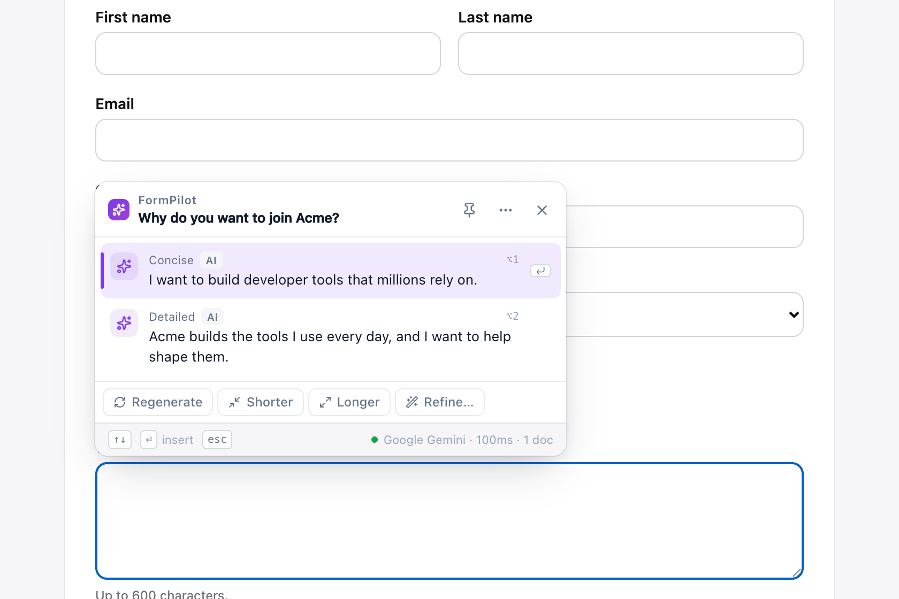

</div>

---

## Contents
- [Why FormPilot](#why-formpilot)
- [Quick start](#quick-start)
- [Features](#features)
- [Screenshots](#screenshots)
- [How it works](#how-it-works)
- [AI providers](#ai-providers)
- [Keyboard shortcuts](#keyboard-shortcuts)
- [Privacy](#privacy)
- [Development](#development)
- [Troubleshooting & FAQ](#troubleshooting--faq)

---

## Why FormPilot

Job applications, onboarding forms, profiles and screening chatbots ask the same questions again and again. FormPilot:

- **knows you.** Answers come from your resume, notes and key facts, not from guesses.
- **stays out of the way.** A small dropdown under the field: ↑ ↓ to choose, Enter to insert.
- **gets faster with use.** Known facts, answers you used before and cached responses fill in milliseconds, with no AI call.
- **learns from corrections.** Type the right answer once and it's remembered for next time.
- **works where others break**: React-controlled inputs, rich-text editors, modals, drawers and chat-style questionnaires such as Naukri's recruiter bot.
- **costs nothing to run.** Free Gemini/Groq/OpenRouter tiers, Chrome's on-device AI, or fully local models through Ollama.

---

## Quick start

### Option A: download (no build needed)

1. Download `formpilot-<version>-chrome.zip` from the [latest release](https://github.com/Naman503/ai-personal-assistant-projects/releases) and unzip it.
2. Open `chrome://extensions` (or `brave://extensions`), turn on **Developer mode**, click **Load unpacked**, and select the unzipped folder.
3. Continue with step 3 below.

### Option B: build from source

**1. Build.** You need Node 20+ and pnpm.
```bash
cd formpilot
pnpm install
pnpm build
```

**2. Load it into Chrome or Brave.**
1. Open `chrome://extensions` (or `brave://extensions`) and turn on **Developer mode**.
2. Click **Load unpacked** and select `formpilot/.output/chrome-mv3`.

`.output` is a hidden folder. In the macOS file picker, press **⌘ + Shift + .** to show it.

**3. Connect an AI provider.** The settings page opens automatically. Paste a free key from [Google AI Studio](https://aistudio.google.com/app/apikey) under **AI Providers**, then click **Test connection**. Optionally upload your resume under **Memory**.

Now click into any form field on any website.

> **After changing code:** with `pnpm dev`, the extension and open tabs reload automatically. With `pnpm build`, click **↻** on FormPilot in `chrome://extensions` and then refresh the page.

---

## Features

<table>
<tr><td width="50%" valign="top">

### ✦ Suggestions under every field
- Several options per field, tagged **Memory / History / AI / Cached**
- **The AI picks the length**: a few words for "City", a paragraph for "Why do you want to join?". It respects `maxlength`.
- Streaming output; **Regenerate · Shorter · Longer · Refine…**
- **Fill the whole form** in one request, with **Undo**

</td><td width="50%" valign="top">

### 🧠 Memory
- Upload **PDF, DOCX, TXT, MD, CSV, JSON, HTML**, or write notes. Files are parsed locally.
- **Key facts** extracted automatically, and editable
- Hybrid search: **BM25 + embeddings**, fused with reciprocal-rank fusion
- Small memories are sent in full; retrieval only kicks in when needed

</td></tr>
<tr><td valign="top">

### ⚡ Speed on repeats
| Layer | Latency |
|---|---|
| Key facts (`Email` → your email) | < 30 ms |
| Saved answers / history | < 30 ms |
| Response cache | ≈ 1 ms |
| AI (streamed) | depends on provider |

</td><td valign="top">

### 🎯 Learns from you
- Type your own answer where a suggestion was wrong, and FormPilot asks **"Remember this answer?"**
- That exact question is then answered instantly, with no AI call
- Short answers become **key facts**; long answers go into a **Saved answers** note
- Modes: **Ask me** / **Save automatically** / **Off**

</td></tr>
<tr><td valign="top">

### 💬 Popups & chat questionnaires
- Renders in the browser **top layer**, above any overlay
- Mounted **inside** the popup, so "click outside to close" doesn't fire
- **Chat questionnaire sites** (Naukri by default): opens the moment the chat box is focused, reads the bot's latest question, and refreshes after every reply

</td><td valign="top">

### 🔌 Providers & models
- Gemini · Chrome built-in AI · OpenRouter · Groq · Ollama · LM Studio · any OpenAI-compatible API
- **Automatic fallback**, retries, backoff
- **Live model picker** with context window, pricing, free badges and sizes
- **Local Models** page: one-click install of open models

</td></tr>
<tr><td valign="top">

### 🪟 A popup that fits how you work
- **Drag it anywhere.** It remembers the spot per site or everywhere, and can stay fixed on screen or follow the field. **Reset** from the ⋯ menu or settings.
- **📌 Pin it** to keep it open while you click around or type
- **Click the field** to bring a closed popup back
- Placement, width, height, opacity, and which parts to show
- **Alt+1…9** inserts a suggestion directly

</td><td valign="top">

### 🔐 Password-protected keys
- API keys are **encrypted** (AES-256-GCM, PBKDF2 600k) with your password or a 4-digit PIN
- Seeing, changing or removing a key needs the password; wrong attempts are throttled
- Optional **strict mode** locks keys after every browser restart
- Keys are never synced or exported

</td></tr>
</table>

---

## Screenshots

| Light | Dark |
|---|---|
|  | 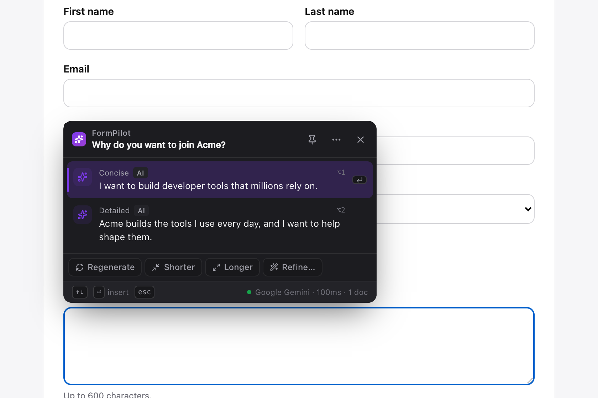 |

| Drag it anywhere (remembered per site) | Popup settings |
|---|---|
| 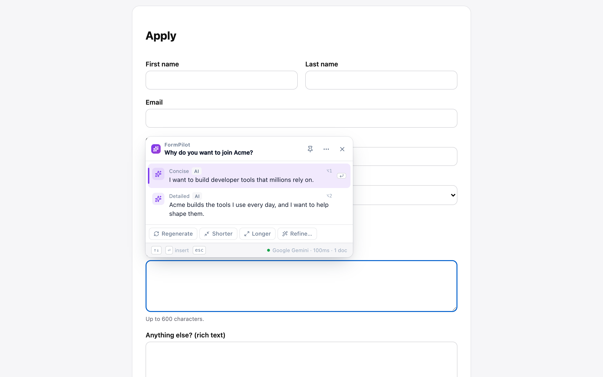 | 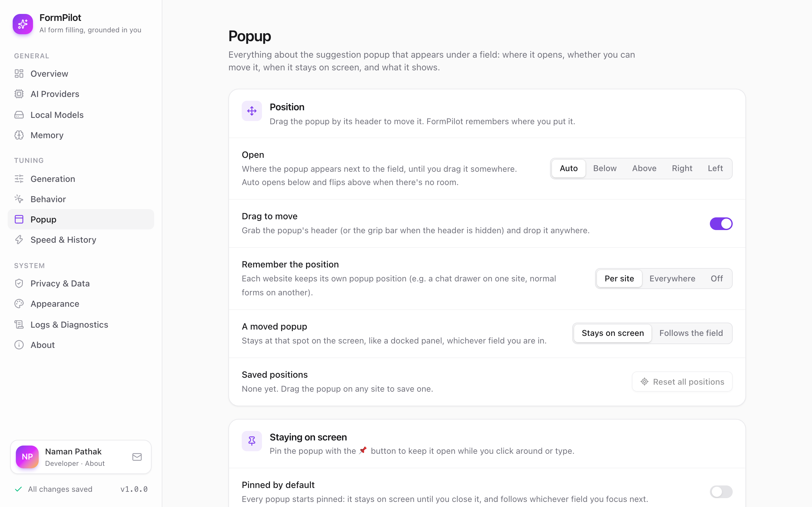 |

| Chat questionnaire in a popup drawer | Toolbar popup |
|---|---|
| 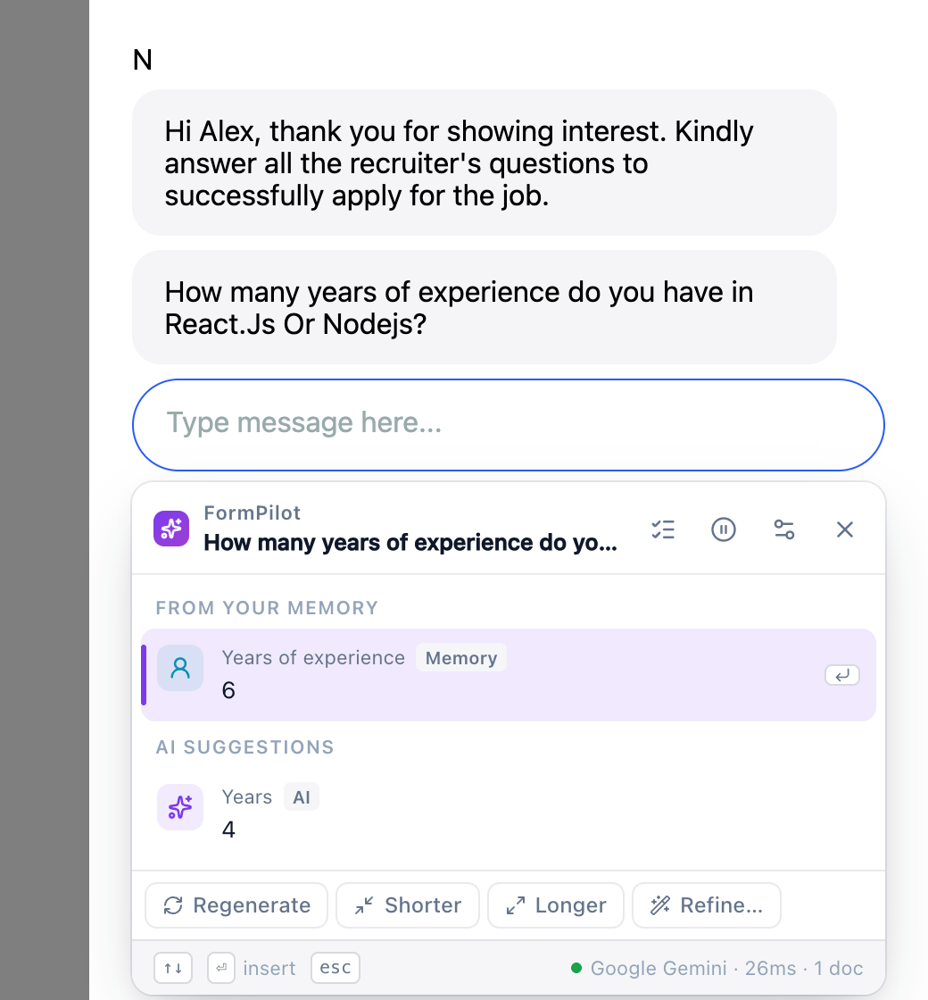 | 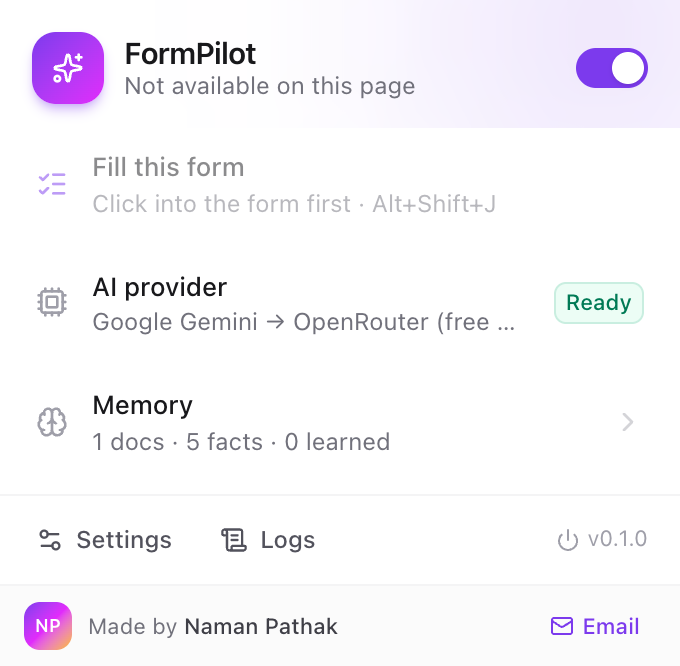 |

<details>
<summary><b>Settings pages</b> (click to expand)</summary>

**Overview**
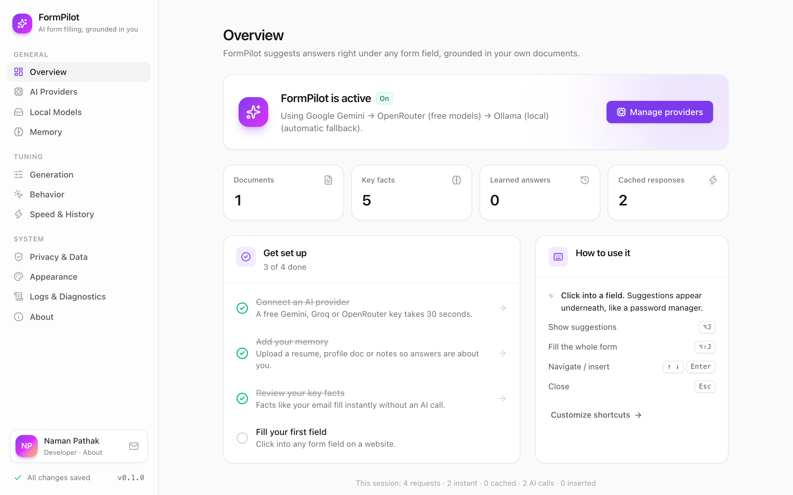

**Live model picker**
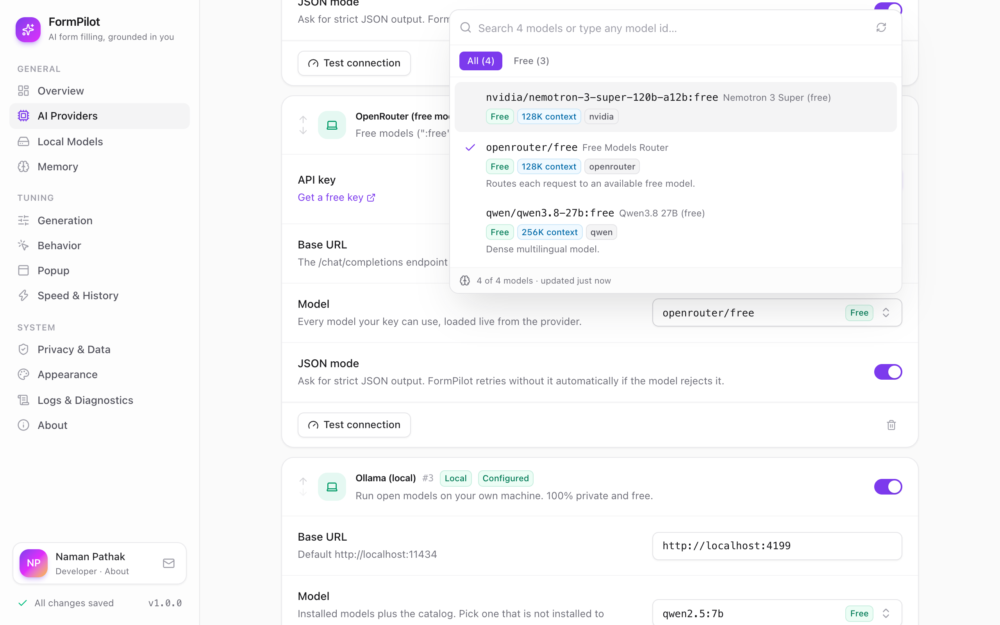

**Local Models (Ollama)**
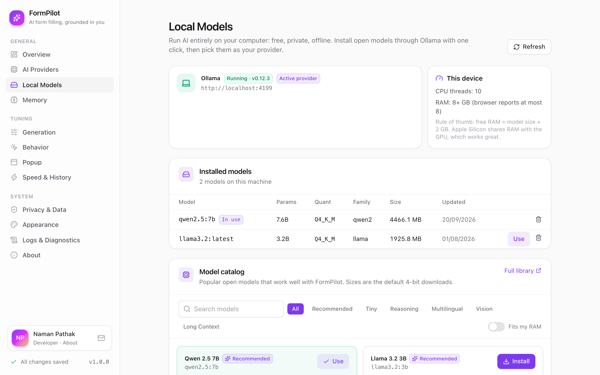

**Memory**
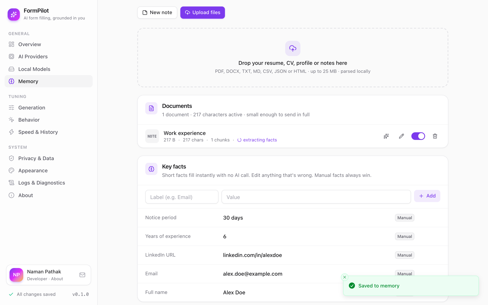

**Privacy & Data (password-protected API keys)**
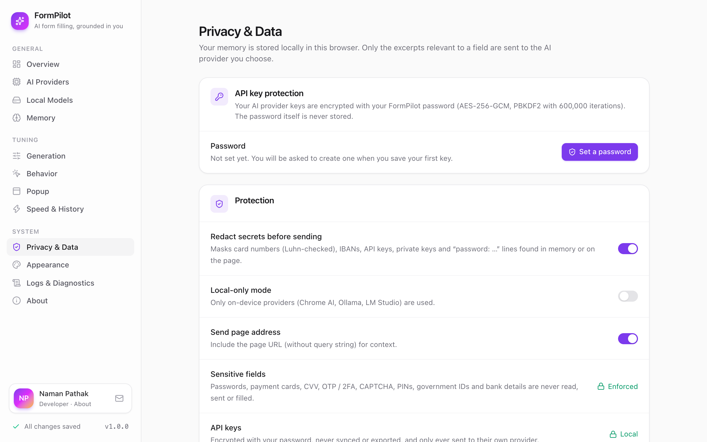

**About**
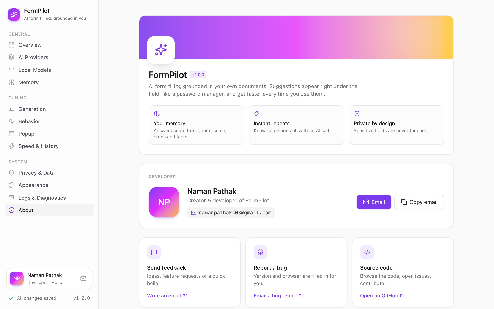

</details>

The screenshots use demo data (a fictional "Alex Doe") and a mock AI server.

---

## How it works

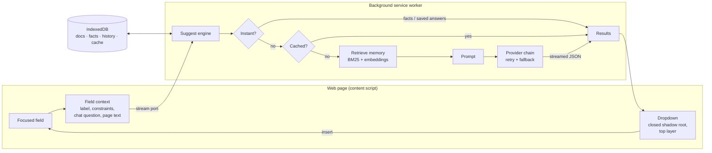

1. **Understand the field.** FormPilot works out what the field is asking from its label, ARIA text, help text, section, constraints and options. For chat questionnaires it reads the bot's latest question.
2. **Answer instantly when possible**, from key facts, your saved answers, or the cache.
3. **Otherwise, ask the AI.** It retrieves only the relevant parts of your memory, builds a compact prompt and streams suggestions back, falling back to the next provider if one fails.
4. **Insert reliably.** It uses native editing commands so React/Vue/Angular see a real input event, with fallbacks for rich-text editors.

The research behind these choices (form-filling benchmarks, retrieval papers, similar projects) is in **[PLAN.md](PLAN.md)**.

---

## AI providers

| Provider | Cost | Runs where | Notes |
|---|---|---|---|
| **Google Gemini** | Free tier | Cloud | Recommended default (`gemini-3.5-flash-lite`). Key from AI Studio. |
| **Chrome built-in AI** | Free | On device | Gemini Nano, Chrome 138+ desktop. Not available in Brave; skipped automatically. |
| **OpenRouter** | Free models | Cloud | `openrouter/free` auto-router or any `:free` model. |
| **Groq** | Free tier | Cloud | Very fast inference. |
| **Ollama** | Free | Your machine | Install models from the **Local Models** page. No `OLLAMA_ORIGINS` setup needed. |
| **LM Studio** / OpenAI-compatible | Varies | Either | Any `/chat/completions` endpoint. |

Providers are tried top to bottom. Turn on **Local-only mode** to never leave your machine.

---

## Keyboard shortcuts

| Action | Shortcut |
|---|---|
| Show suggestions for the focused field | <kbd>Alt</kbd> + <kbd>J</kbd> |
| Fill the whole form | <kbd>Alt</kbd> + <kbd>Shift</kbd> + <kbd>J</kbd> |
| Move / insert / close | <kbd>↑</kbd> <kbd>↓</kbd> · <kbd>Enter</kbd> · <kbd>Esc</kbd> |
| Insert the 1st…9th suggestion directly | <kbd>Alt</kbd> + <kbd>1</kbd>…<kbd>9</kbd> |
| Move the popup | Drag its header; reset from the ⋯ menu |
| Keep the popup on screen | 📌 Pin button in the popup header |
| Save your typed answer | **Save my answer** in the dropdown, or right-click → *remember my answer* |

Change them at `chrome://extensions/shortcuts`.

---

## Privacy

- FormPilot **never reads, sends or fills** passwords, card numbers, CVV, OTP/2FA codes, CAPTCHAs, PINs, government IDs or bank details.
- Secrets in memory are **redacted** before sending: Luhn-checked card numbers, IBANs, API keys and `password: …` lines.
- Your memory lives in this browser's IndexedDB. Only the excerpts relevant to a field go to the provider you chose.
- **API keys are password-protected.** When you save your first key, you create a FormPilot password. Keys are encrypted with AES-256-GCM, using a key derived from the password with PBKDF2-SHA256 at 600,000 iterations. Seeing, changing or removing a key asks for the password; the password itself is never stored. Keys are never synced or exported, and only ever sent to their own provider.
  - **Standard (default):** set the password once. AI suggestions keep working without asking.
  - **Strict:** *Privacy & Data → Lock after the browser restarts*. Suggestions pause after each browser restart until you enter the password once. This also protects against someone with technical access to the computer.
  - **Forgot the password?** *Reset password & keys* removes the password and the saved keys. Memory and settings are kept.
- Forms are never submitted automatically, and consent checkboxes are never ticked.
- Per-site blocklist or allowlist, and one-click **pause on this site**.
- **Anonymous usage, with an off switch.** FormPilot shares which features are used, daily counts of filled fields (and whether they came from memory, history or AI), setup milestones, the provider *type* and error types, with a random id made on install. Never field contents, page addresses, memory, provider URLs, headers or keys, and nothing at all in Local-only mode. Turn it off in *Privacy & Data → Share anonymous usage*; that also deletes what was sent.

---

## Development

| Command | Purpose |
|---|---|
| `pnpm dev` / `pnpm dev:brave` | Dev mode with auto-reload, plus a demo form at <http://localhost:4173/form.html> |
| `pnpm build` / `pnpm zip` | Production build / zip for the Chrome Web Store |
| `pnpm compile` | Type-check |
| `pnpm test` | 136 unit tests (Vitest + happy-dom) |
| `pnpm test:e2e` | 23 end-to-end tests: Playwright drives real Chromium with the extension loaded. Run `npx playwright install chromium` once first. |
| `node scripts/fixture-server.mjs` | Demo/test pages on `:4173` plus a mock OpenAI-compatible AI on `:4174` |

**The end-to-end tests cover:**
- streaming suggestions and keyboard navigation;
- React-controlled inputs and rich-text editors;
- instant facts and sensitive-field protection;
- whole-form fill and provider errors;
- modals with focus traps, and drawers with capture-phase click-outside handlers;
- a copy of Naukri's chat drawer structure, and chats whose messages are visually above the input but later in the HTML;
- learning from corrections;
- password-protected API keys, including strict-mode lock and unlock;
- dragging and remembering the popup position, pinning, click-to-reopen, and Alt+number shortcuts.

**Tech stack:** [WXT](https://wxt.dev) (MV3, Vite) · React 19 · TypeScript · Tailwind CSS v4 · Radix UI · Floating UI · Dexie · MiniSearch · pdf.js · mammoth · zod · Vitest · Playwright

<details>
<summary><b>Project structure</b></summary>

```
formpilot/
├─ src/
│  ├─ entrypoints/
│  │  ├─ background.ts     # service worker: engine, providers, RPC, commands, context menu
│  │  ├─ content/          # in-page dropdown, field watcher, chat-question detection, filler
│  │  ├─ options/          # settings app (11 pages, including About)
│  │  ├─ popup/            # toolbar popup
│  │  └─ offscreen/        # hosts Chrome's on-device model (Prompt API is window-only)
│  ├─ lib/
│  │  ├─ fields/           # field context, classification, eligibility, insertion
│  │  ├─ engine/           # suggest engine, prompts, JSON parsing, cache, history, redaction
│  │  ├─ llm/              # Gemini, OpenAI-compatible, Ollama, Chrome AI, provider chain, catalog
│  │  ├─ memory/           # IndexedDB, parsers, chunker, hybrid retrieval, facts
│  │  └─ settings*.ts      # zod schema + zod-free defaults for the content script
│  └─ components/          # UI kit, model picker
├─ tests/ (unit · e2e · fixtures)
├─ scripts/                # fixture server + mock AI, icon generator
├─ docs/screenshots/
└─ PLAN.md                 # research, architecture, edge cases, test strategy
```
</details>

---

## Troubleshooting & FAQ

<details>
<summary><b>Nothing happens on a page</b></summary>

Refresh the page after installing or reloading the extension. Pages opened before the extension was loaded don't have it yet.
</details>

<details>
<summary><b>"Invalid or missing API key" / "Rate limited"</b></summary>

Fix the key in **Settings → AI Providers** and click **Test connection**. Free tiers have per-minute limits, so add a second provider and fallback takes over automatically.
</details>

<details>
<summary><b>The dropdown doesn't open in a site's chat popup</b></summary>

Add the site under **Settings → Behavior → Chat questionnaire sites** and refresh the page. Then open DevTools on that page, filter the console by `FormPilot`, and check the `chat field diagnostics` line. It shows which question was found and how.
</details>

<details>
<summary><b>Ollama returns 403</b></summary>

Reload the extension once after adding the Ollama provider; the Origin-fix rule is installed on load.
</details>

<details>
<summary><b>"Chrome built-in AI is not available"</b></summary>

It needs Chrome 138+ on desktop with enough disk space and RAM, and Brave doesn't ship it. FormPilot skips it automatically; you can turn that provider off.
</details>

<details>
<summary><b>I forgot my FormPilot password</b></summary>

There's no way to recover it, because the keys are encrypted with it. Click **Forgot password?** in the password prompt, or go to **Privacy & Data → Reset password & keys**, then paste your API keys again. Your memory, facts and settings are kept.
</details>

<details>
<summary><b>Where are the logs?</b></summary>

- **On the website:** its DevTools console, filtered by `FormPilot`.
- **In the background:** `chrome://extensions` → FormPilot → *service worker*.
- **In the extension:** **Settings → Logs & Diagnostics**, which has a live viewer and **Copy diagnostics** (API keys excluded).
</details>

---

## Changelog

See **[CHANGELOG.md](CHANGELOG.md)**. Releases are built and published by CI when a `formpilot-v*` tag is pushed.

## License

[MIT](../LICENSE)
